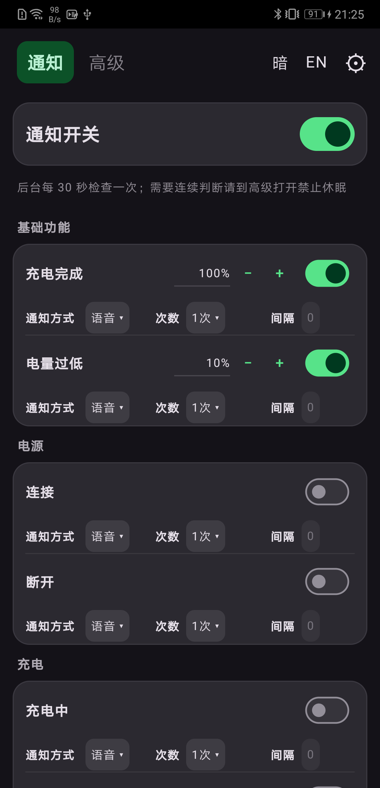
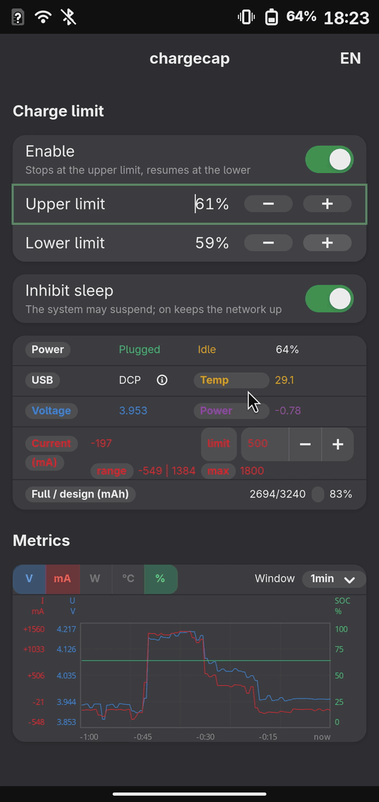
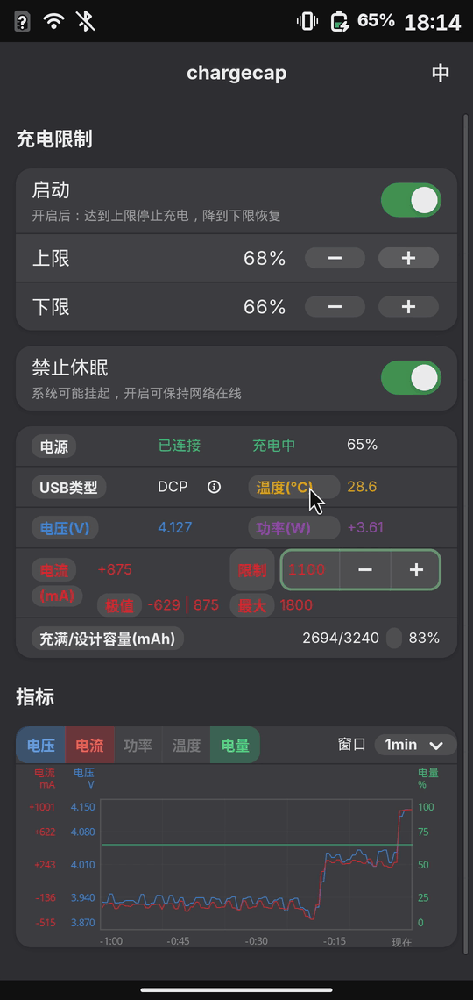

# chargecap（中文名：电电）


[English](README.md) | **中文**

**两件事：通知** 和 **电源状态**。 没 root 权限则退化为电源 / 电池状态监控。支持：

- **Android 7.0（API 24）及以上**：所有机型，不需要 root
- **postmarketOS**：mainline 内核、充电器接口齐备的机型（需要 root，见[支持机型](#支持机型)）

界面是 GTK4/libadwaita 写的，自己不需要任何特权；真正动充电器的是一个 root
守护进程。安卓端是同样的面板、曲线和文案，用 Kotlin + Jetpack Compose 重写。

## 两件事

**1. 通知。** 十三条阈值：充电完成、电量过低、温度、电压、电流、功率、插头和
数据线，每条都可以选横幅或语音，并有自己的次数和间隔。面板关着也照常工作：
安卓每 30 秒醒一次、读一次，不常驻占用 CPU；每次只持 2 秒短锁，让横幅或语音
发出去。要连续 3 秒判断就打开「禁止休眠」。电源插拔由系统广播立即处理。



<br>
<sub>安卓通知页：十三条通知，横幅或语音，长期插电的手机。</sub>


**2. 电源状态。** 电量到**上限**停止充电，降到**下限**恢复，区间内保持现状。
这是 postmarketOS 上需要 root 守护进程的那一半；安卓没有 root 时，限制行会
照常显示但被禁用，其余部分仍可监控。

**核心功能**
- 语音/横幅通知（老人机 充电提醒）
- 限制充电电量
- 限制充电电流
- 状态面板（电压、功率、电流、电流极 / 最大值、温度、充满 / 设计容量、容量百分比、USB 类型、充电状态、连接状态、电量）
- 叠加曲线：电压 / 电流 / 功率 / 温度 / 电量
- 曲线窗口可设定：15s ～ 48h
- 采样间隔可设定：0.01s ~ 20s
- 判断数据线 / 充电器 / 充电宝的质量（掉压多少、能撑多大功率），以及 USB 口能力
- 禁止休眠
- **13 条通知**，分七组：横幅或语音，各有次数与间隔；面板关着也照常提醒
- **语音通知**：充电完成 / 电量过低 / 温度过高等不只显示，还会直接念出来，
  不看屏幕也能听见 —— 给老人、视力不便的人用，手机揣兜里也方便
- **休眠记录**：验证「禁止休眠」有没有真的做到


 

## 支持机型

### Android

**Android 7.0（API 24）及以上的手机全部支持**，不挑机型，也不需要 root。
没有 root 时只做监控：状态面板、曲线、禁止休眠都能用，
充电限制那几行照常显示但被禁用，并注明原因。平台能读出什么、电流怎么测，
见 [`android/README.md`](android/README.md)。

### postmarketOS

支持**类型**：mainline 内核，且充电器公开 `online` / `status` / `usb_type` /
`current_max`、电量计能读出容量 / 电压 / 电流 / 温度的高通机型 —— 这一类已实测。
控制需要 root：界面本身不需要特权，动充电器的是一个 root 守护进程。
其它平台只要这些接口齐备，大概率也能用；节点是按属性找的，详见 `TODO.md`。

## 功能

- **通知**：可自主设定多项阈值，越线就提醒，可选横幅或语音，语音可设定通知次数，可用于老人机用语音提醒充电状态。
- **滞回**：电量到**上限**停止充电，降到**下限**恢复；区间内保持现状。默认 50 / 45（%）。
- **总开关**：关掉后完全不干预充电（电流限制不为 0 时除外）。
- **禁止休眠**：只要这个开关是开的，就一直持有 logind 的 sleep 抑制锁，
  **网络保持在线**（系统挂起会断网）。它与是否插电无关；关掉只是让 chargecap
  不再阻止挂起，之后是否挂起由系统自身的策略决定
- **电源连接状态**：`电源` 已连接 / 未连接
- **充电状态**：`电源` 充电中 / 未充电
- **电量**：%
- **USB 类型**（SDP / DCP / CDP / 未知，旁边 ⓘ 有各值说明）
- **温度**：℃
- **电压**：V
- **功率**：W
- **电流**：mA，实时值、本次会话的**极值**范围 `min | max`、额定**最大**、可改的电流 `限制`，`最大` 是它不能超过的额定值；`0` 表示不限制
- **数据线 / 充电器 / 充电宝的质量**：`电流` 已知时看 `电压` 掉多少 —— 掉得多就是线（或接头）损耗大；`电流` 涨到某个值不再涨、`功率` 跟着卡住，那是充电器 / 充电宝的上限；`USB 类型`（SDP / DCP / CDP）说的是这个口本身能给多少
- **电量统计**：容量百分比 或 充放电电量统计
- **曲线**：同一窗口展示，电压 / 电流 / 功率 / 温度 / 电量可任意多选叠加
- **窗口** 可选 15 秒～48 小时；数据只存在内存里，只记录界面打开期间
- **采样间隔**（`电源` 行右侧的 `采样间隔` 开关）：曲线记录采样点的快慢，
  **13 档，从 0.01 秒到 20 秒** —— 0.01 / 0.03 / 0.05 / 0.1 / 0.3 / **0.5** /
  1 / 2 / 3 / 5 / 10 / 15 / 20 秒，默认 0.5 秒。间隔越短曲线越细、能回看的
  时间越短；两个平台的档位相同，都会记住选择。
- **默认暗色**，标题栏里语言开关前面还有一个"背景"开关（暗色 / 亮色 / 跟随系统）。
- **跟随系统语言**（中文 / English），标题栏右上角可手动切换。
- **休眠记录**（高级，`禁止休眠` 下面）：系统自己睡了多久的记录 —— 用
  boottime 与 monotonic 两只时钟对比数出来，正好用来验证这个开关有没有生效。
  它不是通知（睡了就什么都发不出），也和通知开关无关：次数从最后一次开启
  `禁止休眠` 算起，重启清零，点开一行看历史。

## 安装

### Android

直接装 APK：从 [Releases](https://github.com/fanzu8/chargecap/releases) 下载
`chargecap-<版本>-universal.apk`，在手机上打开安装（或 `adb install -r` 它）。
权限有 `WAKE_LOCK`（禁止休眠）、Android 13 起才会问的通知权限、
`SCHEDULE_EXACT_ALARM`（Android 12 起的 30 秒后台读取；app 的「设置」行会打开
系统页面）、`REQUEST_IGNORE_BATTERY_OPTIMIZATIONS`（电池优化豁免那一行），以及
让通知在没有界面时继续工作的前台服务 / 开机启动两项。第一次打开就是暗色、
跟随系统语言。
想自己编译，见 [`android/README.md`](android/README.md)。

### postmarketOS

```sh
doas apk add py3-cairo     # 另外需要 python3、GTK4 + libadwaita 和 systemd
doas apk add speech-dispatcher espeak-ng   # 语音；没装也不会出错，只是没有声音
git clone <仓库> && cd chargecap
sudo ./install.sh          # 必须在仓库目录里执行
```

全新安装不干预系统：限制关、禁止休眠关、输入限流 0。

```sh
sudo ./uninstall.sh        # 全部清掉，并把充电器恢复成"允许 + 额定限流"
```


## 开发

标准库 Python，没有 pip 依赖；测试不需要手机、不需要 GTK，也不需要 Android SDK：

```sh
python3 -m unittest        # 281 个用例
```

测试不需要手机、GTK，也不需要 Android SDK；CI 在 Python 3.10–3.13 上跑。

不用手机也想看 GTK 界面时，`tools/gtk-preview.py` 会把它指到一棵假 sysfs 树和一份
假守护进程状态上，整个面板就按真机的数值画出来；`--shot` 还能直接渲染成 PNG。
需要 GTK4 + libadwaita + PyGObject（Mac 上 `brew install gtk4 libadwaita pygobject3`）：

```sh
python3 tools/gtk-preview.py                  # 插着电的面板
python3 tools/gtk-preview.py --off            # 没插电、放电中
python3 tools/gtk-preview.py --scheme light --shot panel.png
```

## 许可

[General Pleasure League (GPL) 1.0](https://github.com/fanzu8/General-Pleasure-League)
